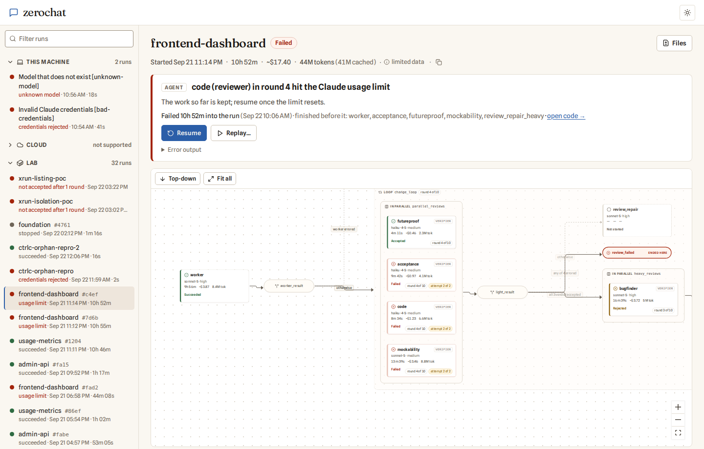

# zerochat

[](https://github.com/tomeyer97/zerochat/actions/workflows/ci.yml)
[](LICENSE)
[](https://www.npmjs.com/package/zerochat)

**Status:** early 0.x release. Expect breaking changes between versions.

zerochat is an independent community project, not affiliated with The Open Engine Company.

[Zeroshot](https://www.npmjs.com/package/@the-open-engine-company/zeroshot) is a command-line tool that runs a team of AI
coding agents on your machine (one writes code, others review it). zerochat is a local web page for
those runs: it lists every run on your machine and shows, for each agent, what it did, what it cost and
why it failed. You can send a message to a running agent, stop a run, or resume a failed one.



Optional pages:

- **Features**: one larger change split into steps, each step one Zeroshot run, done in order and
  merged onto one branch. It needs zsf (Zeroshot features), which comes with zerochat
  ([crates/zsf/README.md](crates/zsf/README.md)).
- **Benchmarks**: optional; needs pb, which is not public yet. Everything else works without it.

## Install

Linux (x64, arm64) and macOS (x64, arm64). Windows: use WSL.

With npm (Node.js `^22.22.2 || ^24.15.0 || >=26.0.0`):

```sh
npx zerochat          # try it
npm i -g zerochat     # keep it; then run `zerochat`
```

If your distribution's Node is older (Ubuntu 24.04 ships Node 18 and no `npx`), get Node from
[nodejs.org](https://nodejs.org/) or [nvm](https://github.com/nvm-sh/nvm).

Without Node: download an archive from [GitHub Releases](https://github.com/tomeyer97/zerochat/releases),
or use the shell installer published with each release.

- [docs/install.md](docs/install.md): every install route, upgrade, uninstall, troubleshooting.
- [docs/verify.md](docs/verify.md): check that a download was built by this repository's CI.

**Requires Zeroshot 16.1 or later** (`npm i -g @the-open-engine-company/zeroshot`) to stop, resume and
message runs. Reading runs works without it. Messaging one agent instead of the whole run needs a Zeroshot
whose `zeroshot steer --help` lists `--node`.

## Run it

```sh
zerochat             # serve on http://127.0.0.1:4380/ and open your browser
zerochat doctor      # check the setup; each problem names its fix; exits 1 on a problem
zerochat --help      # every flag
```

Settings: [docs/configuration.md](docs/configuration.md) (port, browser, `config.toml`, environment variables).

## Security

The local API has **no authentication**: any user or program on this machine that can reach the port
can read your runs and stop, resume or message them. zerochat listens on loopback only and checks the
`Host` header, so other web pages cannot drive it. `--allow-remote` serves on a non-loopback address
(anyone who can reach it gets the same access); `--any-host` (used by `make remote`) turns off the `Host`
check and is only for running behind a proxy that logs you in. Details: [docs/threat-model.md](docs/threat-model.md);
report problems as [SECURITY.md](SECURITY.md) says.

## Build from source

Prerequisites: Rust 1.90.0 (pinned in `rust-toolchain.toml`; rustup installs it), Node.js
`^22.22.2 || ^24.15.0 || >=26.0.0` with npm (`.nvmrc`), a C compiler and make. Details:
[CONTRIBUTING.md](CONTRIBUTING.md#prerequisites).

```sh
make                 # check Node, build the web UI, zerochat and zsf, serve it and open it
make install         # install `zerochat` and `zsf` into ~/.cargo/bin
make test            # Rust, web and npm-shim tests
```

## More

- [CONTRIBUTING.md](CONTRIBUTING.md): how to work on it. [DESIGN.md](DESIGN.md): what it promises and how.
- [CODE_OF_CONDUCT.md](CODE_OF_CONDUCT.md)
- [SUPPORT.md](SUPPORT.md): questions go to [GitHub Discussions](https://github.com/tomeyer97/zerochat/discussions).
- [SECURITY.md](SECURITY.md)
- [CHANGELOG.md](CHANGELOG.md); versioning: [RELEASING.md](RELEASING.md#versioning)
- License: [MIT](LICENSE)
