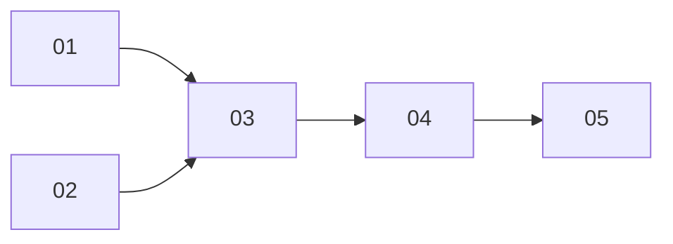

# Slices of the toy feature

Merge order: 01, 02, 03, 04, 05.

| # | Slice | Depends on | Parallel with | Covers | Size |
|---|-------|------------|---------------|--------|------|
| 01 | [Add the `limits` table](01-limits-table.md) | — | 02 | R1, R12 | S |
| 02 | [Parse **limits** config](02-parse-config.md) | none | 01, 03 | R2 | M |
| 03 | [Enforce limits](03-enforce.md) | 01, 02 (after R12 lands; ~2 days) | 04 | R3, N05 | L |
| 04 | [Report usage](04-report.md) | 01–03 | 05 | R4 | M |
| 5 | [Docs](05-docs.md) | 4 | — | R10, 03 | S |

## Spec issues found while slicing

Slice 02 must land within 14 days; see 03 and 05.
