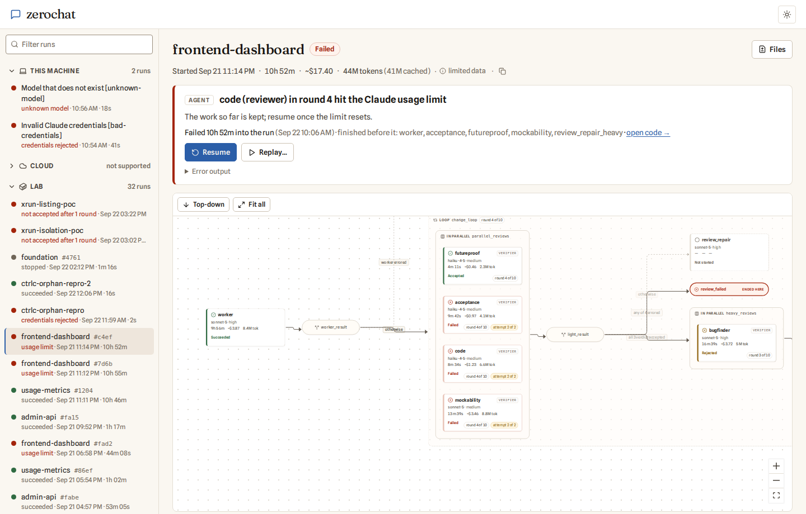

# zerochat

A local web UI for [Zeroshot](https://www.npmjs.com/package/@the-open-engine-company/zeroshot) runs: every
run on your machine, what each agent did, what it cost and why it failed. Message a running agent, or
resume a failed run from a checkpoint.



zerochat is an independent community project, not affiliated with The Open Engine Company.

## Install

```sh
npx zerochat          # try it
npm i -g zerochat     # keep it; then run `zerochat`
```

## Requirements

- **Zeroshot 16.1 or later** (`npm i -g @the-open-engine-company/zeroshot`). zerochat reads runs without
  it; stopping, resuming and messaging runs go through the `zeroshot` command.
- **Node.js** `^22.22.2 || ^24.15.0 || >=26.0.0` (only for the launcher; the server is a native binary).

## Platforms

| OS | CPU | package |
|---|---|---|
| Linux (any distribution, static musl build) | x64, arm64 | `@zerochat/cli-linux-x64`, `@zerochat/cli-linux-arm64` |
| macOS | x64, arm64 | `@zerochat/cli-darwin-x64`, `@zerochat/cli-darwin-arm64` |

npm installs the one for your machine as an optional dependency; there is no install script. Windows: use
WSL. The package also installs `zsf` (Zeroshot features), which zerochat's Features page uses.

## Run

```sh
zerochat             # serve on http://127.0.0.1:4380/ and open your browser
zerochat doctor      # check the setup; exits 1 on a problem
zerochat --help      # every flag
```

## Verify

Every release is built and published by GitHub Actions from a version tag, with npm provenance:
`npm audit signatures` checks it. Details: [docs/verify.md](https://github.com/tomeyer97/zerochat/blob/main/docs/verify.md).

## Links

- [README](https://github.com/tomeyer97/zerochat#readme)
- [Install, upgrade, uninstall](https://github.com/tomeyer97/zerochat/blob/main/docs/install.md)
- [Security policy](https://github.com/tomeyer97/zerochat/blob/main/SECURITY.md)
- [Verify a download or an npm install](https://github.com/tomeyer97/zerochat/blob/main/docs/verify.md)
- Licence: MIT; bundled third-party licences are in `THIRD_PARTY_NOTICES.md` in this package.
